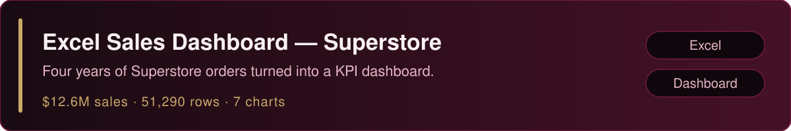
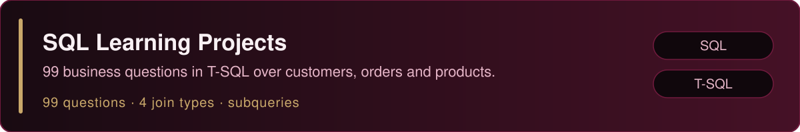

  

## About me

Hello, I'm Arsalan. I'm an aspiring data analyst and MSc Data Science student at Chandigarh University, with a B.Sc. IT background.

I'm interested in transforming raw data into meaningful insights using spreadsheets, SQL, Python, data analysis, and visualization. My focus is on building practical projects and improving my analytical problem-solving skills — through data cleaning, SQL querying, Python-based analysis, and clear dashboards and charts.

I'm early in my data analytics journey and learning in public: every project below is real work from my own repositories, described as it actually is.

## Technical skills

**Spreadsheets and data analysis**

- Microsoft Excel — data cleaning, SUMIFS/COUNTIFS summaries, native charts, KPI dashboards

**Querying and databases**

- SQL (T-SQL / SQL Server) — filtering and sorting, aggregate functions, GROUP BY and HAVING, INNER / LEFT / RIGHT / FULL OUTER joins, subqueries

**Python and data analysis**

- Python, pandas, NumPy — data cleaning and exploratory analysis

**Data visualization**

- Matplotlib, Seaborn — charts for analysis notebooks

**Tools**

- Git, GitHub

## Featured projects

- Cleaned a 51,290-row Superstore dataset (Jan 2011 – Dec 2014) and built a dashboard with 5 KPI cards and 7 native charts. Findings: $12,642,502 in sales, $1,467,457 in profit (11.6% margin); Tables was the only loss-making sub-category (−$64k); the 0% discount band ran at +25.3% margin versus −111% for the 51%+ band.
- Note: summaries in this workbook use SUMIFS/COUNTIFS equivalents rather than PivotTables or slicers.

- Missing-value and duplicate checks, discount validation, group-by summaries, a monthly Net Amount trend, and correlation analysis — saved as a cleaned dataset with 5 charts (bar, pie, scatter, box, heatmap). Findings: 613 records have a negative Net Amount because the discount exceeded the gross amount, while the Net Amount formula itself is consistent throughout.
- Note: the analysis notebooks and cleaned dataset are in the repo; the raw source file itself is not included.

- 99 numbered business-oriented practice questions plus a second query file, in T-SQL (SQL Server) over customers, orders, products, employees, and books/borrowings tables — demonstrating filtering and sorting, aggregates, GROUP BY and HAVING, all major join types, and subqueries.

More of my work: [github.com/arsalanwani?tab=repositories](https://github.com/arsalanwani?tab=repositories)

## What I'm learning

- Practical data analysis and exploratory data analysis
- SQL problem-solving
- Python-based data manipulation
- Dashboard design, including Power BI

## GitHub stats

## Connect with me

- **GitHub:** [github.com/arsalanwani](https://github.com/arsalanwani)
- **LinkedIn:** [linkedin.com/in/arsalan-shafi2002](https://www.linkedin.com/in/arsalan-shafi2002)

  

