  

## About me

Hi, I'm **Arsalan Wani** — an aspiring data analyst and MSc Data Science student at Chandigarh University, with a B.Sc. IT background.

I'm interested in transforming raw data into meaningful insights using spreadsheets, SQL, Python, data analysis, and visualization. My focus is on building practical projects and improving my analytical problem-solving skills — through data cleaning, SQL querying, Python-based analysis, and clear dashboards and charts.

I'm early in my data analytics journey and learning in public: every project below is real work from my own repositories, described as it actually is.

## Technical skills

**Spreadsheets and data analysis**

- Microsoft Excel — data cleaning, SUMIFS/COUNTIFS summaries, native charts, KPI dashboards

**Querying and databases**

- SQL (T-SQL / SQL Server) — filtering and sorting, aggregate functions, GROUP BY and HAVING, INNER / LEFT / RIGHT / FULL OUTER joins, subqueries

**Python and data analysis**

- Python, pandas, NumPy — data cleaning and exploratory analysis

**Data visualization**

- Matplotlib, Seaborn — charts for analysis notebooks

**Tools**

- Git, GitHub

## Featured projects

### 1. Excel Sales Dashboard — Superstore Sales Analysis

Four years of Superstore order-line data, organized and analyzed into a dashboard that communicates what actually drove sales and profit.

- **Tools:** Microsoft Excel
- **What I did:** cleaned a 51,290-row dataset (Jan 2011 – Dec 2014), standardized headers and trimmed product names, built SUMIFS/COUNTIFS summaries, and created a dashboard with 5 KPI cards and 7 native charts, plus a Documentation sheet.
- **Key findings:** $12,642,502 in sales and $1,467,457 in profit (11.6% margin). Tables was the only loss-making sub-category (−$64k). Discount depth drives margin: the 0% discount band ran at +25.3% margin, while the 51%+ discount band ran at −111%.
- **Note:** summaries in this workbook use SUMIFS/COUNTIFS equivalents rather than PivotTables or slicers.

🔗 [github.com/arsalanwani/excel-Project-practice](https://github.com/arsalanwani/excel-Project-practice)

### 2. E-commerce Sales Analysis

Exploratory analysis of a 55,000-record e-commerce sales dataset — cleaning it, checking its logic, and finding where the numbers don't behave as expected.

- **Tools:** Python, pandas, NumPy, Matplotlib, Seaborn
- **What I did:** missing-value and duplicate checks, discount validation, value counts and group-by summaries by gender, age group, product category, purchase method, and location, a monthly Net Amount trend, and correlation analysis — saved as a cleaned dataset with 5 charts (bar, pie, scatter, box, heatmap).
- **Key findings:** 613 records have a negative Net Amount because the discount exceeded the gross amount, while the Net Amount formula (Gross − Discount) itself is consistent throughout. The box plot showed similar medians and spread across age groups, with one high-value outlier.
- **Note:** the analysis notebooks and cleaned dataset are in the repo; the raw source file itself is not included.

🔗 [github.com/arsalanwani/E-commerce-Python-Data-Analytics](https://github.com/arsalanwani/E-commerce-Python-Data-Analytics)

### 3. SQL Learning Projects

A collection of practical SQL work: 99 numbered business-oriented practice questions plus a second query file, written in T-SQL (SQL Server) over customers, orders, products, employees, and books/borrowings tables.

- **Tools:** SQL (T-SQL / SQL Server)
- **What it demonstrates:** filtering and sorting, aggregate functions, GROUP BY and HAVING, INNER / LEFT / RIGHT / FULL OUTER joins, and subqueries — for example, finding the category with the highest average product price using a subquery.

🔗 [github.com/arsalanwani/SQL-Learning](https://github.com/arsalanwani/SQL-Learning)

More of my work: [github.com/arsalanwani?tab=repositories](https://github.com/arsalanwani?tab=repositories)

## What I'm learning

- Practical data analysis and exploratory data analysis
- SQL problem-solving
- Python-based data manipulation
- Dashboard design, including Power BI

## GitHub stats

## Connect with me

- **GitHub:** [github.com/arsalanwani](https://github.com/arsalanwani)
- **LinkedIn:** [linkedin.com/in/arsalan-shafi2002](https://www.linkedin.com/in/arsalan-shafi2002)

  

